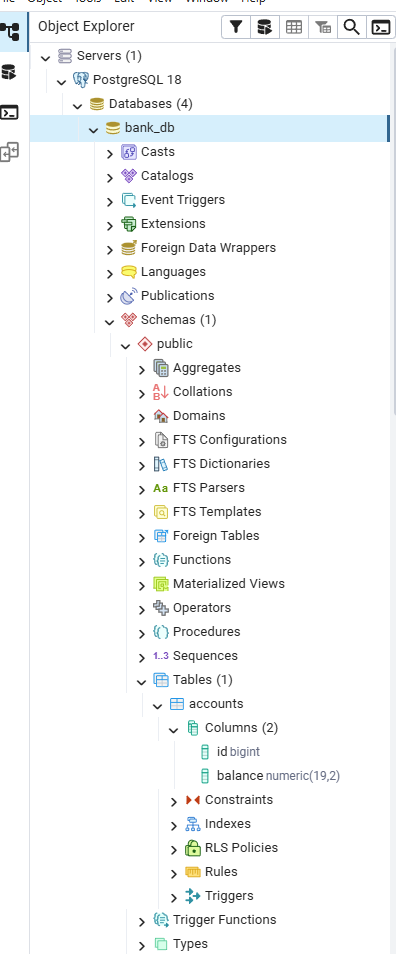

# bank-api

REST API для интернет-банка (учебный проект).

## Функциональность

- **getBalance** — узнать баланс по ID пользователя
- **putMoney** — пополнить баланс
- **takeMoney** — снять деньги со счёта

## Стек

- Java 21
- Spring Boot 4.1.1
- PostgreSQL 18
- Spring Data JPA / Hibernate
- Lombok
- Maven

## Структура БД

Таблица `accounts`:




Дамп БД: [`db/bank_db_dump.sql`](db/bank_db_dump.sql)

## Запуск

### 1. Восстановить БД

```bash
psql -U postgres -d bank_db -f db/bank_db_dump.sql