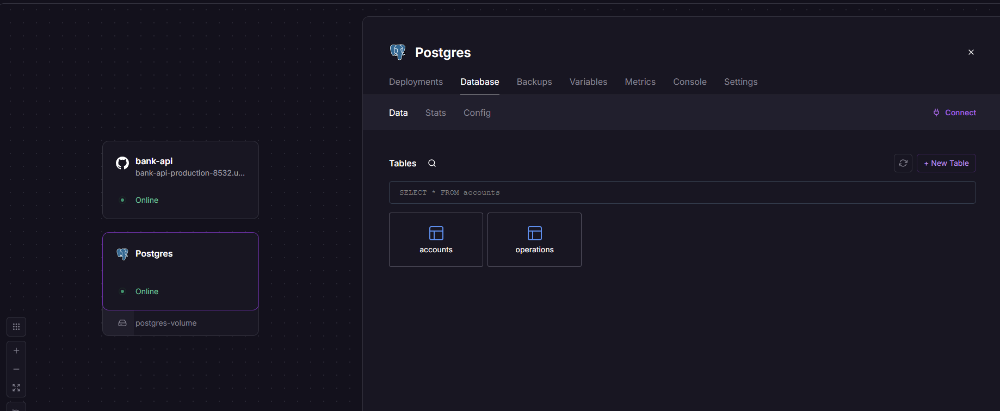

# 🏦 Bank API

REST API для управления банковскими счетами, написанный на Java (Spring Boot). Проект реализует базовые банковские операции с гарантией целостности данных.

## 🚀 Демо (Deploy)
Приложение развернуто и доступно по ссылке:  
🔗 **[https://bank-api-production-8532.up.railway.app](https://bank-api-production-8532.up.railway.app)**

## ⚙️ Реализованный функционал
- ✅ Получение текущего баланса счета (`GET /api/account/balance/{id}`)
- ✅ Пополнение счета (`POST /api/account/put/{id}`)
- ✅ Снятие средств со счета (`POST /api/account/take/{id}`)
- ✅ **Перевод средств между счетами** (`POST /api/account/transfer`) с проверками (достаточность средств, запрет перевода самому себе).
- ✅ **Гарантия целостности:** Операция перевода защищена аннотацией `@Transactional` (атомарность: если сбой, отменяется и списание, и зачисление).
- ✅ Получение истории операций с фильтрацией по датам (`GET /api/account/operations/{id}`).

## 🛠 Технологический стек
- **Java 21**
- **Spring Boot 4.1.1** (Web, Data JPA, Validation)
- **PostgreSQL** (Реляционная база данных)
- **Hibernate / JPA** (ORM)
- **JUnit 5 + Mockito** (Юнит- и интеграционное тестирование)
- **Maven** (Сборка)

## 🗄 Структура базы данных

*(Полный SQL-дамп структуры и тестовых данных находится в файле `dump.sql` в корне репозитория).*

## 🚀 Как запустить локально
1. Убедитесь, что у вас установлена **Java 21** и запущен **PostgreSQL**.
2. Создайте базу данных `bank_db`.
3. Примените дамп из файла `dump.sql`.
4. В файле `src/main/resources/application.properties` укажите свои локальные данные для подключения к БД.
5. Запустите проект: `mvn spring-boot:run` или через IDE.

## 🧪 Тесты
Проект покрыт тестами. Для запуска выполните:

`bash`

`mvn clean test`

*(Включает юнит-тесты сервисного слоя и интеграционные тесты репозиториев).*